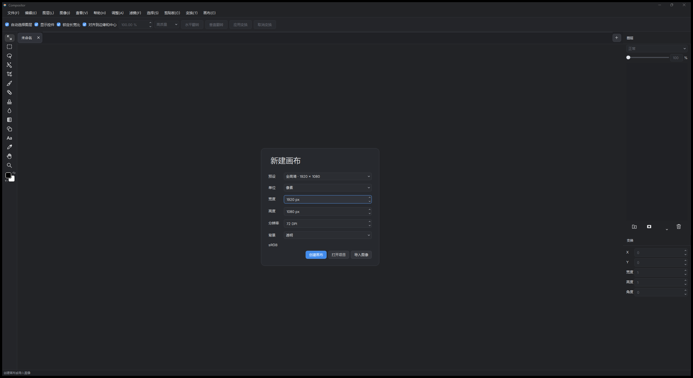

# Compositor Windows 简体中文汉化说明

本分支（`l10n-zh`）为 [Compositor Windows](https://github.com/Cengokill/CompositorWindows)（Robbie Tilton 的 [Compositor](https://github.com/robbietilton/Compositor) 的社区 Windows 移植版）提供**简体中文界面**。基于官方 v1.1.0 源码（上游锁定 `a19db90`）直接修改源码字符串并本机重编译，非运行时补丁。



## 使用

- 运行时布局与官方便携版一致：解压后双击 `Compositor.exe` 即可，运行库与抠图模型已内置。
- 可与英文官方版**共存**，互不干扰。
- Windows 11 x64；未签名构建，首次运行如遇"未知发布者"提示选择"仍要运行"。

## 汉化范围

| 类别 | 情况 |
|---|---|
| 菜单栏（文件/编辑/图层/图像/查看/帮助/调整/滤镜/选择/剪贴板/变换/画布） | ✅ 全部中文，助记符保留为 `文件(&F)` 形式 |
| 工具栏与工具选项栏（移动/选框/套索/魔棒/画笔/橡皮擦/修复/仿制图章/渐变/文本等） | ✅ |
| 面板（图层、变换、色板、直方图、Camera Raw 全套滑杆） | ✅ |
| 字体下拉预览 | ✅ 每个字体名后附中文样字"永东"，直观展示该字体（或其回退）的中文渲染效果 |
| 对话框（新建画布、导入/导出、滤镜、效果、快捷键编辑器、更新面板、命令面板） | ✅ |
| 状态栏与提示消息 | ✅ |
| 术语 | 对齐 **Photoshop 中文版**：正片叠底/滤色/色相饱和度/色阶/曲线/内容识别填充/剪贴蒙版/羽化/仿制图章…… |
| 保留不译 | 品牌名 Compositor、技术缩写 sRGB/DPI/px/PSD/EXR/HEIC/RAW、单位、快捷键字母 |
| 保留英文 | 极少数开发者诊断日志与内部断言（不出现在正常使用界面） |

翻译词条约 **1532+ 条**（界面文案 1206 条 + 用户可见错误/状态消息），由 9 路并行流水线按统一术语表（《l10n-tools/TRANSLATE-RULES.md》）完成，人工复核特殊场景（尾随空格、`%1` 占位符、`\n` 转义、拼接语序）。

## 技术实现

1. **源码级替换**：上游无 QTranslator/i18n 基础设施（`windeployqt --no-translations`），因此按"整串精确匹配、仅替换字符串字面量内部"的策略直接改写 `src/` 源文件（`l10n-tools/apply-translations.mjs`），QSS 样式表、对象名、JSON 键一律不动。
2. **编码**：全部目标已带 `/utf-8` 编译选项，中文字面量直接合法；Qt 6 的 `const char*` 按 UTF-8 转换。
3. **字体回退**：原版全局强制 Inter 字体（无 CJK 字形）。`VisualStyle.cpp` 已加 `Microsoft YaHei UI / Microsoft YaHei / SimHei` 回退链（`QFont::setFamilies` + 全局样式表），中文显示清晰无豆腐块。
4. **混合模式显示/序列化分离**：`blendNames` 是写入 `.comp` 项目文件的序列化标识符，**保持英文**；新增 `blendDisplayNames` 中文数组仅在两个下拉框显示层使用（`blendDisplayName(i)`）。

## 项目文件兼容性（重点）

`.comp` 项目是目录包，manifest 里存有枚举字符串。为保证**旧英文项目可打开**，持久化/解码层全部改为**读侧中英双语兼容、写侧保持英文**：

| 字段 | 读取 | 保存 |
|---|---|---|
| `blendMode` | 英文（原样） | 英文 |
| `transform.sampling` | `Nearest/Smooth/High quality` 或 `邻近/平滑/高质量` | 英文 |
| `shape.kind` | `Rectangle/Ellipse/Line` 或 `矩形/椭圆/直线` | 英文 |
| 调整 `kind`（色阶/曲线/曝光/渐变映射/颗粒/高斯模糊…12 种） | 中英双语 | 跟随编辑来源（见"已知限制"） |
| 文本 `alignment` | `Left/Center/Right` 或 `左/居中/右` | 英文 |
| 字体样式默认值判断 | `Regular/常规/Normal` 均视为默认 | — |

**已知限制（单向兼容）**：

- ✅ 官方英文版保存的项目 → 中文版可正常打开（已做双语解码）。
- ⚠️ 中文版新建的**调整图层**保存后 `kind` 为中文（如"色阶"）。官方英文版打开此类项目会因枚举校验失败而拒绝——中文版自身读写无碍。混合模式/形状/对齐等其余字段均已写英文，不受影响。如需完全双向兼容，可在 `defaultAdjustmentJson` 与调整对话框应用路径补一个中文→英文回写映射。

## 从源码构建

工具链（与上游锁定版本一致）：VS 2022 Build Tools **MSVC 14.44**、Windows SDK **10.0.26100.0**、CMake **3.31.6**（VS 自带）、Python 3.12、Qt **6.8.3**（锁定包）。

```powershell
# 依赖预下载(本机 schannel 故障时可用 Node 通道,见 l10n-tools/fetch-deps.mjs)
# 三个图像库固定 tag 克隆 + onnxruntime 解压 + 模型就位后:
. .\scripts\bootstrap-imaging.ps1 -SkipModel
. .\scripts\bootstrap.ps1 -Offline -RuntimeDirectory <官方便携版目录>
cmake --preset windows-x64-release
cmake --build --preset windows-x64-release --target Compositor --parallel 16
# 产物 build/release/Release/Compositor.exe,直接替换官方便携版目录中的同名文件即可
```

> 注意：**构建路径须为纯 ASCII**。中文路径会使 MSVC `lib.exe` 的响应文件乱码（LNK1181）。

## 上游更新后的维护流程

`l10n-tools/` 内含完整流水线，可复用：

1. `extract-strings.mjs` → 提取全部字符串字面量（`out/strings.json`）
2. `make-chunks.mjs` → 分块；新串翻译后合并入 `out/dict-*.json`（沿用 `TRANSLATE-RULES.md` 术语表保证一致性）
3. `apply-translations.mjs` → 精确替换回源码
4. `audit-residual.mjs` / `extract-bare.mjs` → 两轮查漏（含无空格纯单词标签）
5. 重编译、替换 exe、验证

词典（`out/dict-*.json`，1532 条）与规则随仓库提供，也可作为其他语言本地化的起点。

## 许可与致谢

- 汉化修改遵循原仓库 **MIT** 许可，未改动任何版权声明。
- 原作 [Robbie Tilton](https://robbietilton.com/compositor)（Compositor，MIT © Wonder Assembly LLC）；Windows 移植 [Cengokill/CompositorWindows](https://github.com/Cengokill/CompositorWindows)（由 IAmTheBlurr 发起指导）。
- 本地化不改变任何第三方组件（Qt/LGPL、libheif/libde265/LGPL、LibRaw/CDDL、ONNX Runtime/MIT、BiRefNet/MIT、Inter/OFL）的许可义务，相关通知随官方包分发。
